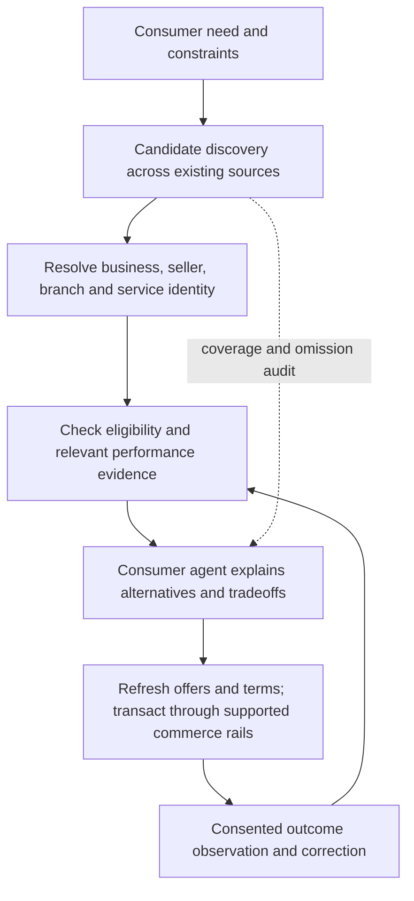

# Business discovery through useful, portable performance evidence

Concept revision: October 26, 2026. Owner: Black 4. Status: a proposed architecture with a working synthetic reference. This paper separates implemented behavior, supported integration patterns and hypotheses requiring real participants. It grants no provider access, hosted deployment or upstream endorsement.

## The outcome we want

A person should be able to ask an agent, “Which business can meet my need, at an acceptable price, with evidence I can understand?” A business should have a practical route to being considered because of the service it delivers, even when it has less advertising money or brand recognition. The consumer retains the decision about what matters.

Open Commerce Performance (OCP) explores a small part of that future: portable, scoped operational evidence that different discovery systems and agents can interpret. The business is the subject of the comparison. A particular product or service supplies the context in which its performance matters.

The ambition is broader than improving the order of product listings. It is also harder. An evidence format cannot find every business, authenticate every real-world event, remove advertising incentives, or compel an AI platform to recommend fairly. Those are separate responsibilities that a credible concept must address.

## What should change about discovery

Search relevance, editorial recommendations, consumer reviews and advertising can each supply useful information. Their outputs answer different questions. A persuasive page, popular brand, highly rated product and reliable delivery operation are not interchangeable evidence of a business's suitability for a particular need.

The proposed improvement is to make the basis of a recommendation inspectable: which businesses were considered; which were omitted or unknown; which facts were observed; whose assertions they are; what they actually cover; and how the person's priorities affected the choice. Better machine-readable persuasion is insufficient. The evidence must constrain what an agent is entitled to conclude.

For example: a merchant offering a $24 shipped basket may have 900 of 1,000 historical orders on time and complete. A $20 competitor may have 750 of 1,000. A third charges $18 and has no usable published history. A shopper prioritizing that historical record may choose the first; a price-first shopper may choose the third. Neither preference makes a merchant the universal winner. Unknown history does not establish poor performance. Historical observations do not guarantee the next order.

The shipped basket in the reference holds product and availability constant. It is an experimental control for comparing sellers, not a limit on the eventual concept's importance. The reference cannot generalize its result to all orders, other branches, restaurant meals or the quality of the product itself.

## Three meanings of discovery

**Candidate discovery:** Which businesses might meet this need? Search, maps, directories, marketplaces, recommendations and specialist agent indexes can propose candidates. A candidate list has coverage and incentive limitations. Verifying three candidates perfectly says nothing about a fourth business never considered.

**Capability discovery:** Given a business endpoint, how can an agent interact with it? UCP business profiles describe supported services and capabilities. This is distinct from searching the world's competing businesses. UCP's location capabilities also support search/lookup of physical locations from a business. [Official UCP overview](https://ucp.dev/specification/overview/), [location overview](https://ucp.dev/specification/common/location/).

**Suitability assessment:** Which candidate is an appropriate choice for this person, need and moment? This requires current eligibility, relevant evidence, comparable methods and consumer priorities. OCP proposes evidence for that assessment. It neither replaces candidate discovery nor prescribes a global ranking.

A useful integration needs all three. Focusing only on signing claims would leave the hardest discovery and distribution problems untouched.

## The commerce stack and its responsibilities

| Responsibility | Existing or prospective owner | OCP's bounded contribution |
|---|---|---|
| Express intent | Person and their chosen agent | Preserve explicit requirements and unresolved preferences |
| Find candidates | Existing search/maps/directories, marketplaces and agent indexes | Preserve candidate provenance; allow evidence-aware indexes without requiring one central directory |
| Resolve subject | Authoritative business endpoints, identifiers and verified relationships | Bind a claim to the exact responsible subject and scope |
| Establish current eligibility | Merchant's supported catalog/location/service and offer interfaces | Do not substitute historical evidence for present serviceability, inventory, terms or capacity |
| Observe performance | Authorized operational sources and suitable independent observations | Versioned methods, counts, coverage and limitations over minimized populations |
| Verify and assess | Consumer-side verifier and agent policy | Origin/status checks plus explicit comparability and assurance limits |
| Authorize and transact | Existing commerce, checkout and payment systems | Pass a chosen business/offer into those systems; never treat a claim as purchase authority |
| Correct and evaluate | Existing authority owners, verifiers, consumers and researchers | Correction/status references and evaluation designs; no claim of an implemented global adjudicator |

This is a logical map, not a demand for eight new services. In Black 4's own future integration, Platform Control retains identity, consent, Reviews and receipts; Connector Hub retains provider access; MDW retains governed evidence. Other implementers can use their existing owners of equivalent responsibilities.

## A brand is not always the responsible business

A brand can cover many legal entities, franchisees, locations, sellers, channels and product lines. A marketplace can host independent sellers. A manufacturer can supply products whose delivery and returns are handled by someone else. These relationships change over time.

The proposed subject model therefore distinguishes the organization, trading brand, seller account, branch/location, service/fulfillment channel and specific product or service. Each mapping needs an authority, effective period and provenance. Existing vocabularies such as Schema.org distinguish Organization, Brand and LocalBusiness relationships; using those names or a shared logo does not verify a relationship. [Schema.org Organization](https://schema.org/Organization), [LocalBusiness](https://schema.org/LocalBusiness).

A branch's performance must not automatically roll up into a brand claim. A brand claim must not automatically roll down to every branch. An acquisition, franchise change, reseller relationship or domain change needs explicit handling; a new name cannot silently inherit a favorable history or erase an unfavorable one. Product identity likewise cannot inherit a merchant's operational reputation.

The reference implements fixed merchant identities only. It does not yet implement a legal-entity or brand/branch resolution model. The immediate next identity experiment should cover two branches with different records, plus a seller operating under a shared brand, before broad “brand performance” language enters the contract.

## How UCP fits

UCP supplies a credible integration path because it already separates capabilities and supports namespaced extensions. Its location search can express proximity/service-area needs within a business's locations; catalog and transaction capabilities provide a route from consideration to an actual offer. These mechanisms do not establish a cross-business performance ranking. [Location search](https://ucp.dev/specification/common/location/search/).

There are three integration options to evaluate:

1. **Existing catalog-reference experiment.** The implemented offline extension attaches a merchant-scoped evidence reference to catalog lookup. This is useful when product/offer discovery comes first. It validates against immutable `v2026-08-25` schemas and keeps unsupported-client products unchanged. It does not make catalog lookup the universal home of business reputation.
2. **Business-first evidence access.** An agent that has identified a business could retrieve an independent evidence resource before choosing a product. A future vendor root capability or another supported reference mechanism might expose it through UCP discovery. The right contract, identity binding, supported release and client behavior still need design and testing. No invented core member, fabricated standard link relation or unsupported extension parent is introduced here.
3. **Context-specific references.** A future negotiated reference on a supported location or service operation could bind evidence closer to the entity performing the work. It should be attempted only against the chosen release's actual extension contract, with base-client behavior and cross-scope rejection tests. It is not implemented by the current catalog fixture.

Keep the aggregate evidence independent of its discovery attachment. A business found through maps, a directory or an agent could expose the same properly authorized evidence, and a UCP client could ignore it safely. Independence does not guarantee platform acceptance or distribution. Clients still need an implemented fetch path, trust policy and interpretation contract.

UCP's vendor-first process is an appropriate place to experiment before requesting core adoption. Major core changes follow its own proposal and council process. [Contribution guidance](https://ucp.dev/documentation/contributing/). The prototype's `ai.black4.commerce.performance` fixture remains unhosted and experimental. Its JWS evidence verification does not implement UCP HTTP Message Signature authentication. These secure different objects and must both be tested where applicable.

ACP can carry the later commerce/checkout interaction through a supported integration. AP2 addresses payment authorization and accountability. Poppy addresses broader personal-agent/company interaction. None of those integrations is implemented here, and no platform is obliged to ingest OCP because it supports one of those protocols. See [ecosystem positioning](ECOSYSTEM_POSITIONING.md) and the [dated alignment ADR](ADRs/0001-upstream-alignment.md).

## How evidence would reach an AI recommendation

The intended mechanism is explicit retrieval and interpretation at decision time. A participating agent finds candidate businesses through its normal sources, follows supported evidence references, checks the claims and uses them within the consumer's policy. A searchable evidence-aware index could help retrieve candidates earlier; the diagram is a separation of responsibilities, not a requirement that every search follow a rigid one-way sequence. Index snapshots still need authoritative refresh and correction handling.

Publishing an open endpoint does not put a business into every model's training data, make it appear in ChatGPT or Google, or force a platform to fetch or respect the evidence. Distribution requires client integration and a reason for those clients to serve consumers well. Human-readable pages can explain the same facts, but snippets, copied summaries and cached model memories cannot substitute for a current status check when the claim is used.

The design goal is to make grounded recommendations possible, not to manipulate model wording or smuggle instructions into merchant content. Verification and hard eligibility constraints should run outside the language model where practical. The model can clarify intent and explain tradeoffs, but must not turn a signed metric into a guarantee, silently relax a constraint or obey instructions embedded in retrieved material. Test an actual independently built agent on those cases; the deterministic reference does not prove model behavior.

## The evidence has to survive interpretation

A useful claim needs a precise subject; method and version; population, period and geography/channel/service scope; exact counts and missing observations; source lineage; publication and observation times; current correction/withdrawal status; issuer identity and financial relationships; and explicit assurance limits. Different source and measurement problems must remain different states.

Before recommending, a consumer should establish: this business can meet the current need; the statement is actually about the responsible subject; the method measures an outcome relevant to this need; the source population and periods are comparable; and the evidence is current enough and sufficiently supported for the intended use. Only then should price and preference policy decide among eligible alternatives. Otherwise the consumer asks a question, seeks more evidence, presents a limited comparison or abstains.

A signature authenticates bytes and origin under a trust assumption. Internal arithmetic checks establish coherence. Recomputing private rows establishes reproducibility over those rows. Independent corroboration and audit are additional claims requiring actual evidence. Coherent fabricated rows can pass the first three. Complete order reconciliation, immutable original promises and appropriate independent delivery observations are examples of stronger source work; none should be claimed from a convenient timestamp alone.

Historical context matters. Promises can be lengthened to inflate on-time rates. Restrictive refund policies can reduce refunds while making consumers worse off. Product mix, distance, price, customer selection, carrier and season can change an aggregate. Large historical populations do not make these differences disappear. Avoid a single weighted index that launders these effects into “quality.” Publish separate contextual facts and test whether they support the inference being made.

Reviews also retain a role. Narrative feedback can reveal treatment, accessibility and experiences absent from operational systems. It should preserve provenance and moderation integrity, and remain distinct from observed fulfillment metrics. Existing Google review presentation rules already distinguish self-serving organization reviews from eligible independent review material; the evidence should not be relabelled as stars to borrow that presentation. [Review snippet guidance](https://developers.google.com/search/docs/appearance/structured-data/review-snippet). The FTC likewise emphasizes authentic consumer experience in review platforms. [FTC platform guidance](https://www.ftc.gov/business-guidance/resources/featuring-online-customer-reviews-guide-platforms).

## A discovery process an agent could actually run

Suppose the consumer wants a reasonably priced grocery business that can deliver to their address and cares about dependable service. The agent translates the need into eligibility constraints and asks about a missing budget or deadline when it changes the outcome. It retrieves candidates from more than one suitable source where possible, records the source boundaries and separates sponsored placements from evidence-based assessment.

It resolves the seller/location and current service area, retrieves applicable performance statements through supported references, verifies origin/status and compares only compatible populations. It explains alternatives in ordinary language: “A costs more and has this historical record; B is cheaper with this different record; C has unknown history.” It does not claim to have evaluated the entire market. The agent then refreshes the selected offer and promise through the business's supported commerce interface before asking for any required purchase authority.

If the person instead asks for pickup tonight, the shipped-order records do not transfer. Even a price-first choice needs evidence that the business offers the requested service. If an index omits a new business, an accurate verifier does not repair that omission. If the data comes only from a merchant's own systems, the agent must not call it independent observation.

The current demo now runs this narrow scope boundary: all three candidates are explicitly seeded; changing from shipped orders to pickup or prepared meals yields `scope_not_established`, including when price is the priority. It makes no real serviceability claim. This is a working canary for a broader architecture, not a global discovery implementation.

## How this could improve competition—and how it could fail

The causal hypothesis is: easier access to relevant, credible evidence improves consideration and selection for businesses delivering outcomes consumers value; those businesses earn enough return to keep improving service; consumers get better outcomes at acceptable total cost. Each link needs measurement. More exposure, more clicks or a different recommendation is insufficient by itself.

| Failure mode | Design response to test | Remaining difficulty |
|---|---|---|
| Advertising or affiliate payment influences the recommendation | Separate placements, disclose compensation, exclude compensation from the evidence rule | A consuming platform can still apply its own incentives |
| Large businesses win because they have more history | Treat sparse/absent evidence as unknown; preserve alternative routes to consideration | High-assurance requirements can still exclude entrants |
| Connected merchants are mistaken for the whole market | Report candidate source and coverage; audit omissions; support multiple indexes | No index can prove complete global coverage |
| Merchants publish only favorable cohorts or reset identities | Fixed method/bundle rules, reconciliation, identity continuity, visible status | Voluntary withdrawal and external truthful records require distinct handling |
| A paid verifier becomes the new reputation gatekeeper | Portable methods, multiple issuers, disclosed conflicts, independent challenge | Independence and verification cost remain economic problems |
| AI treats a signed claim as instruction or truth | Parse bounded typed data; ignore embedded instructions; separate origin from assurance | Different agents may still interpret evidence inconsistently |
| Metrics reward gaming or worse terms | Show original promises, price and policy context; test harm and adversarial cases | Methods need continued scrutiny as behavior changes |

Cold start deserves an explicit policy. A business with little history may offer a price, a clear promise, consumer protection or independently supported facts that justify consideration. A person can choose such a business knowingly. An opt-in exploration policy could surface qualified newcomers, but must not expose people to concealed risk or relax a hard requirement without their consent. The reference does not implement exploration or statistical confidence ranking; its minimum-population suppression is a privacy control, not a proof that 30 observations are enough for reliable forecasting.

## Economics, governance and rights

Someone pays for extraction, verification, serving, correction and evaluation. Charging for those services is different from selling a favorable verdict. A viable business model must make affordable entry possible, permit export and competing verification, and state who funds each issuer. Black 4's work for merchants creates a real potential conflict to disclose; an open schema does not erase it. A merchant-funded issuer must not certify itself as independent.

Decisions about methods, acceptable comparisons and disputes should have published versions, change rationale, participation from consumers and businesses of different sizes, and a way to challenge issuers as well as merchants. No central universal score or exclusive directory is required. Whether this eventually belongs in an existing standards group, an independent multi-party method process or both remains open. This paper establishes no new governing body.

Authorization to read private operational records is distinct from consent to publish aggregates. Withdrawal stops use of the consented feed and invalidates its current claims under the applicable contract. It does not grant the business a universal right to erase independently and lawfully established facts. Old signatures must not revive withdrawn evidence; histories must not silently reset to a favorable blank. Correction, archival, retention and disclosure rules need a concrete jurisdiction-appropriate design before a pilot.

Consumers should not have to reveal personal purchase histories to every candidate merely to compare businesses. Prefer minimized local intent and aggregate evidence. Sparse cells, repeated releases and linkage across datasets need separate privacy analysis; suppressing a small cell alone is not a privacy guarantee. The reference exposes no individual records and adds no cross-merchant customer tracking.

## A world-scale fit without pretending the world is uniform

Start with a narrow, well-observed service outcome. Different industries need different methods. A restaurant, repair service, hotel and shipped retailer cannot share a generic on-time denominator. A future method should identify the service, accountable entity, outcome, measurement limits and intended use before a domain adapter is built. Professional, health, financial and other consequential recommendations need domain expertise and standards beyond this reference.

Methods and evidence envelopes can be portable while languages, currencies, promises, service geography, consumer protections and source availability remain local. Preserve original units, timestamps and locale-specific terms; localize explanation without changing the method. Treat franchise/marketplace responsibility, verifier authority and cross-border processing explicitly. Do not require every small business to run its own cryptographic infrastructure; existing platforms can serve evidence on its behalf with verifiable delegation and withdrawal.

World-scale success would mean many discovery providers, many consumer agents and multiple accountable issuers can exchange intelligible evidence without a single owner deciding who counts as a good business. That is a design objective, not a property the current repository proves.

## What to build and what would count as evidence

| Stage | Concrete artifact | Acceptance evidence |
|---|---|---|
| Working concept, now | Existing comparator plus interactive stack and business-context gate | Different preferences choose different merchants; unrelated service contexts abstain; no stale result after failed read; explicit seeded coverage |
| Real protocol interoperability | One selected UCP discovery/reference path and separately implemented consumer | Safe real profile/schema fetching, identity/signature/version handling, unsupported-client fallback and withdrawal canary; no claim from fixture-only validation |
| Identity and method challenge | Branch/brand counterexamples, independent fabricated-source and missing-population cases | No silent inheritance; no out-of-scope recommendation; bad source assurance stays distinguishable from good arithmetic |
| Consented narrow pilot | Reconciled operational populations and independently justified source observations | Documented eligibility, consent, coverage, correction and actual known source limits; no broad quality badge |
| Consumer and competition evaluation | Frozen baseline, transparent experiment and measured outcomes | Pre-specified analysis of price, service failures, task completion, regret, exposure/selection for small/new businesses, harm, participation cost and withdrawals |

For evaluation, compare the existing discovery/recommendation approach with the same candidate set plus evidence first; that isolates evidence interpretation. Then separately test candidate expansion, because discovery coverage and ranking effects must not be confounded. Use the same time window and eligibility rules, distinguish intent-to-treat from actual exposure, report missing follow-up, and size the experiment using the actual baseline and a meaningful effect before claiming lift. Run adversarial tests alongside—not instead of—consumer studies.

Do not optimize only for merchant conversion. A higher conversion rate with worse outcomes or higher hidden cost fails the consumer objective. An average benefit hiding exclusion of small businesses or disadvantaged consumers also needs correction. Evidence of better competition requires longer observation than a synthetic preference switch.

## Open questions the concept should invite

- What makes a candidate set sufficiently diverse and transparent without claiming complete market coverage?
- Which business identity relationships can existing systems establish authoritatively, especially for franchises and marketplaces?
- Which UCP business-first reference or capability boundary is most useful to independent consumers, alongside the existing catalog experiment?
- What affordable assurance tier helps small/new businesses without overstating reliability?
- Who can challenge a funded issuer, and what happens to contested data while a challenge is resolved?
- Will agents use this evidence faithfully, and will people understand its limits better than a familiar star rating?
- Does it measurably improve outcomes people value, and do service improvements actually earn businesses more opportunity?

The [gap report](IMPLEMENTATION_GAP_REPORT.md), [methods](METRICS.md), [architecture](ARCHITECTURE.md), [upstream ADR](ADRs/0001-upstream-alignment.md) and [pilot plan](MERCHANT_PILOT_PLAN.md) remain the technical evidence behind this proposal. The interactive concept is an aid to reasoning, not a claim those open questions have been solved.
