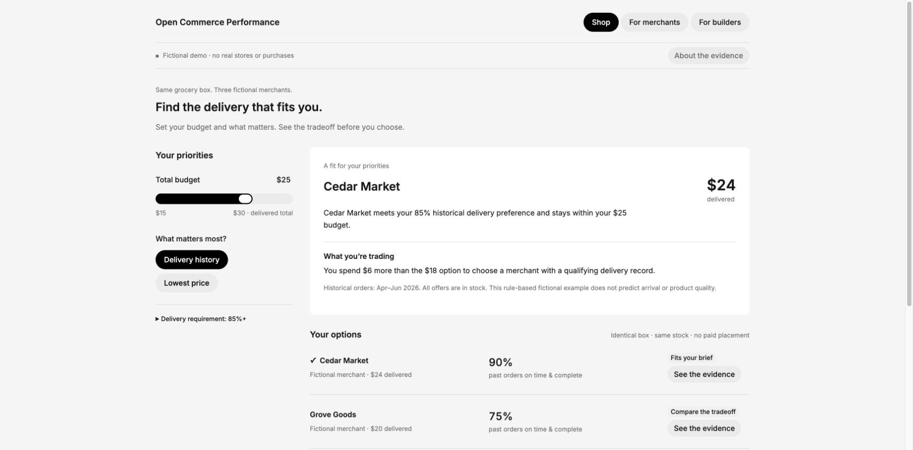
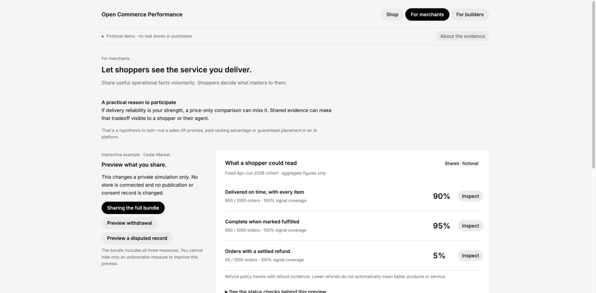
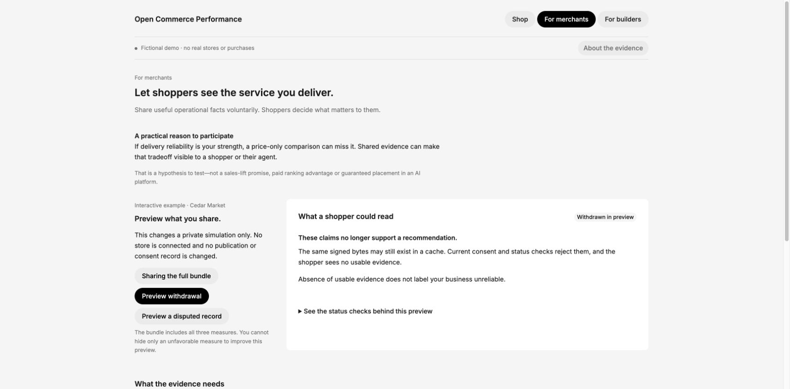
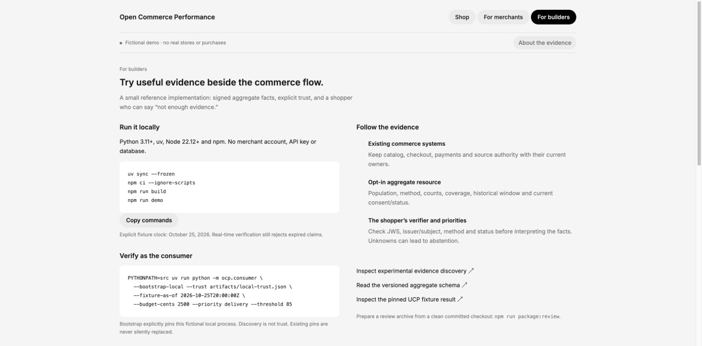

# Better choices from useful operational facts

**Private review package · synthetic reference · prepared 2026-10-25.** No merchant data, purchasing, deployment, upstream submission or platform endorsement.

A shopper choosing the same grocery box can prefer low price or an established delivery record. A merchant can voluntarily make that record understandable. An agent can independently verify signed origin and current status before deciding what the facts mean for that shopper. No universal merchant score or paid ranking advantage.

## Try the three paths

Run the [quickstart](../README.md), then open `http://127.0.0.1:8787`.

- **Shop:** set a $25 budget and 85% historical delivery preference → Cedar Market at $24. Lower that preference to 75% → Grove Goods at $20. Price first → Little Pantry at $18, while its delivery history stays unknown. A $19 delivery-first budget or 95% threshold leads to an understandable abstention.
- **For merchants:** inspect Cedar's full three-measure bundle, source requirements and privacy boundary. Preview withdrawal or a disputed state through actual signature/status rules. Nothing connects, publishes or changes the served registry.
- **For builders:** run the independently pinned consumer, inspect the schema/JWS/status resources and reproduce a release-pinned UCP vendor-extension experiment. Unsupported clients retain unchanged base catalog behavior.

The controls change bounded shopper preferences, never source cohorts. Refund incidence is shown with its policy and never becomes a low-is-good product-quality ranking. The consumer verifier does not rely on the issuer's `/verification` result. Signatures authenticate origin; they do not establish source truth, completeness or independent audit.

## The contribution

Keep discovery, catalog, checkout and payments in existing protocols. Explore one optional namespaced catalog reference to independently consumable aggregate evidence. Each claim carries counts, population/window, coverage, method, issuer/incentives and current status; the shopper owns the decision.

The local UCP fixture uses immutable `v2026-08-25` schemas at `87dd4b1fcff9105d68173120897237fa784c74ef`. It includes an unhosted vendor namespace, exact-version fixture intersection and composition with a distinct field. It is not a live UCP endpoint, complete negotiator or certification. ACP's checked source uses dated `2026-04-17`; no undocumented feed fields are added. AP2 v0.2.0 remains the payments boundary. Square is a verified UCP Food Technical Council participant; its APIs/MCP remain prospective consented OCP source integrations. Neither participation nor API access implies OCP adoption. Poppy is adjacent/deferred: deployed Draft 0.3 docs and public repository version metadata differ, explicitly recorded in the audit. OCP adds no auth/session layer.

**Question for UCP builders:** is catalog lookup the right extension parent for a merchant-scoped aggregate reference, or should the evidence remain an external opt-in resource? The [specific discussion draft](DRAFT_UCP_DISCUSSION.md), [ecosystem positioning](ECOSYSTEM_POSITIONING.md) and runnable positive/adversarial fixtures make that question concrete. ACP and Square have distinct integration questions and data contracts.

## Review the evidence

[Architecture](ARCHITECTURE.md) · [methods](METRICS.md) · [JWS profile](ADRs/0002-jws-profile.md) · [exact upstream audit](ADRs/0001-upstream-alignment.md) · [validation](../VERIFICATION.md) · [gaps](IMPLEMENTATION_GAP_REPORT.md) · [consented pilot](MERCHANT_PILOT_PLAN.md).

This demonstrates coherent behavior on fictional data. Consumer enthusiasm, merchant commercial benefit and real recommendation improvement remain hypotheses. Next, test comprehension with people and consented merchant/source coverage before claiming utility or distributing live evidence.

## Package and release boundary

`npm run package:review` exports allowlisted committed files from a clean HEAD into a deterministic ZIP with a per-file SHA256 manifest. It excludes ignored artifacts/trust pins, dependencies, git internals, environment/key files and machine-local paths. Upstream licenses/notices travel with it. [Apache-2.0 is recommended](LICENSE_RECOMMENDATION.md) for a reviewed public release; it has not been applied to Black 4-authored code.

The package is ready for private technical review. Making the repository public, applying a public license, hosting a demo, sending the package to named companies and posting upstream remain explicit human decisions about the finished artifact.

## Walkthrough images

